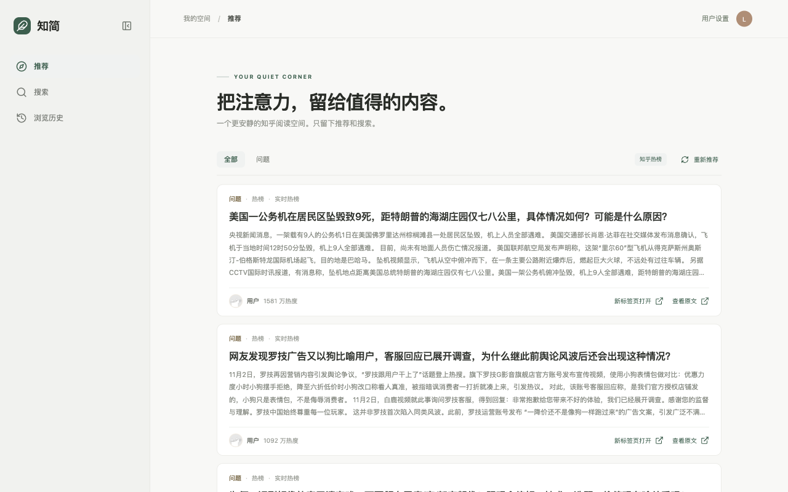
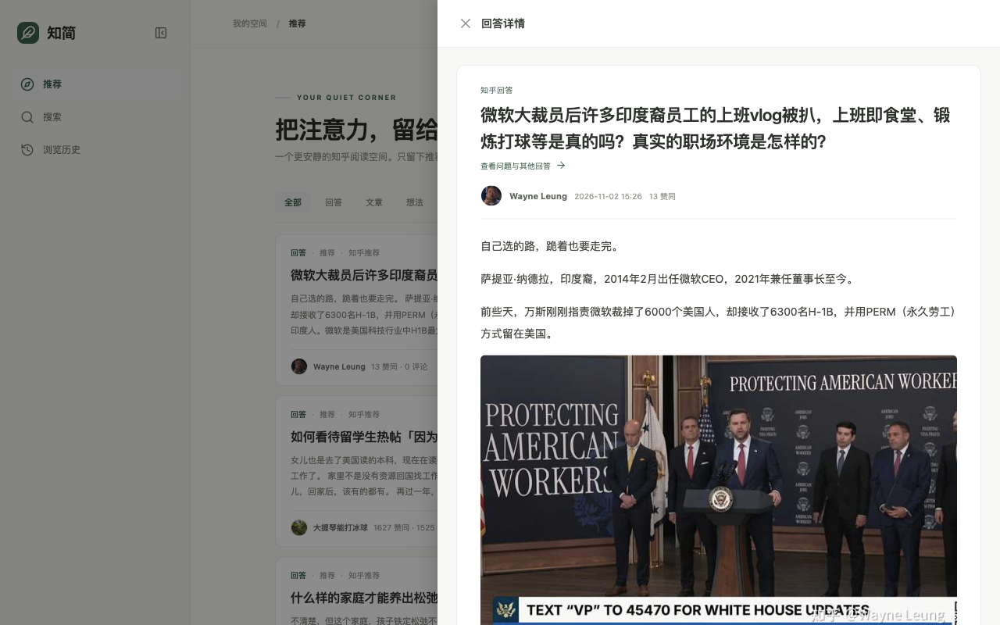

# 知简 Zhihu Focus

本地知乎阅读器，提供推荐流、搜索和云端浏览历史。





## 启动

终端一：

```bash
cd ~/work/zhihu-focus
./scripts/start-backend.sh
```

Air 未安装时，在项目根目录运行 `./scripts/install-air.sh`。

终端二：

```bash
cd ~/work/zhihu-focus/frontend
pnpm dev
```

打开终端里给出的本机地址，默认 `http://127.0.0.1:5173`。同一局域网内的其他设备可以用终端里的 Network 地址。不同浏览器各自保存 Cookie 和阅读设置。局域网地址使用 HTTP，只在可信网络中使用。

## 配置 Cookie

点击右上角「用户设置」，在菜单里选择「设置与 Cookie」，粘贴知乎 Cookie。Cookie 只保存在当前浏览器里。不要把 Cookie 发到聊天或提交到仓库。

没有 Cookie 时，推荐流显示知乎热榜。详情、评论和浏览历史需要先配置 Cookie。

可选在 `backend/.env` 配置 `ZHIHU_ACCESS_SECRET`，模板见 `backend/.env.example`。搜索在没有可用 Cookie 时用它兜底。

## 阅读

侧栏有推荐、搜索和浏览历史。点击回答或文章，在当前页右侧打开正文和评论。从回答可以进入问题页，查看问题信息和回答列表。想法暂时跳到知乎原页。

卡片上的「新标签页打开」可以单独打开回答、文章或问题，地址可以直接分享。阅读仍需要访问者在自己的浏览器里配置 Cookie。

个人设置里有「滚到底自动加载」，默认关闭。

在站内成功打开回答或文章后，会向知乎上报已读，并写入云端浏览历史。侧栏「浏览历史」读取这份云端记录，支持刷新和翻页。切换或清除 Cookie 后，页面不再显示上一个账号的历史。

## 服务器部署

在本机安装 Go、pnpm 和 Docker 后，执行 `./scripts/build-image.sh` 构建前后端镜像。用 `docker save` / `docker load` 传到服务器，再用 `compose.yaml` 启动。已有的 HTTPS 站点可引入 `deploy/openresty-zhijian.conf`，把 `/zh/` 转到前端。

Kubernetes 的可提交清单是 `deploy/k8s.yaml`，里面没有命名空间、私有仓库地址和密钥。这些写在 `deploy/k8s.local.yaml`，该文件已加入 `.gitignore`，不要提交。部署自己的集群时使用 `kubectl apply -f deploy/k8s.local.yaml`。

服务器部署目录的 `.env` 里可以设置 `ZHIHU_ACCESS_SECRET`。不要把这个文件打进镜像或提交到仓库。能访问网站的人都会用到这份搜索兜底，按使用范围控制站点访问。`/zh/` 与同域名的其他页面共用浏览器来源，同域页面应可信，以免其他脚本读到浏览器里保存的 Cookie。
